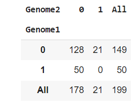
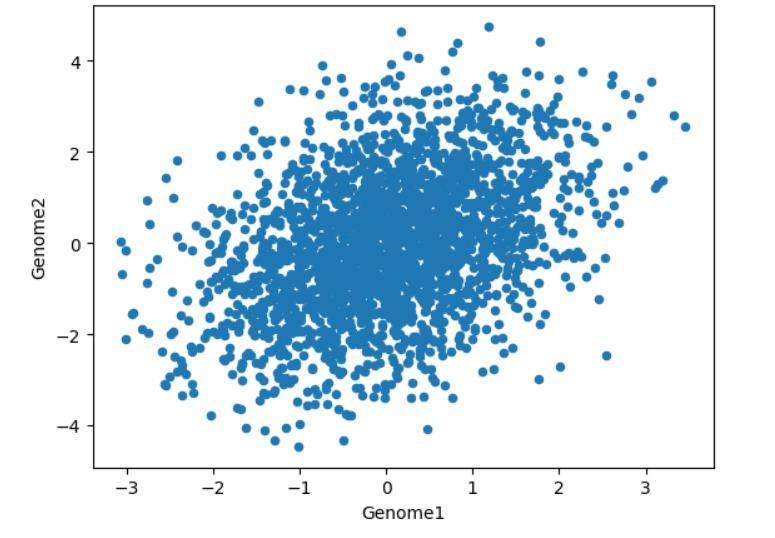
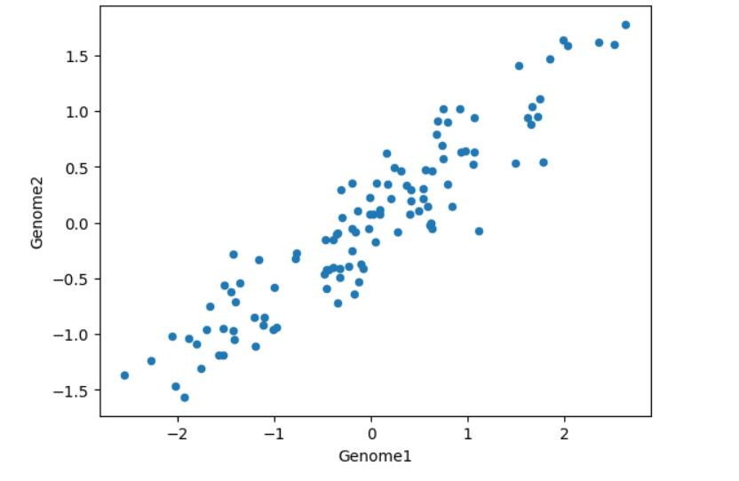
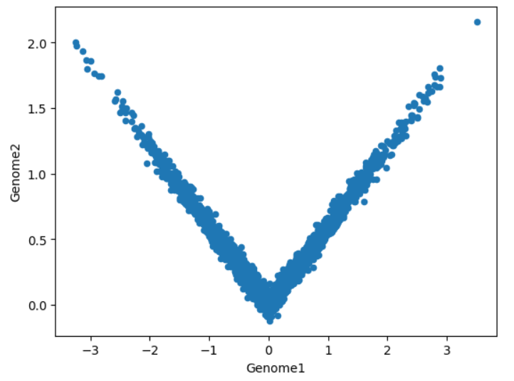

# Genomic Variant Association Analysis

[](https://www.python.org/)
[](LICENSE)
[](data/)

Statistical analysis of genomic variants in *Arabidopsis thaliana*, quantifying association between variants and testing its significance with several complementary methods.

## Key Results

- **Two genomic variants, 199 plants:** no significant association. Mutual information 0.033, Jaccard index 0.0, χ² 7.878 (p ≈ 0.096) — the variants never co-occur in this sample and appear mutually exclusive.
- **Gene expression profiles:** the strongest association is in dataset `p2b` (Pearson r = 0.931, p = 3.74 × 10⁻⁴⁹), followed by `p2a` (r = 0.381, p = 1.04 × 10⁻⁸³), then `p2c` (r = 0.041, p = 0.059, not significant).
- **Ranking is consistent across all three checks** — correlation, p-value, and scatter-plot inspection: **p2b > p2a > p2c**.
- **Correlation can miss non-linear structure:** the `p2c` scatter plot shows a clear V-shaped (curvilinear) pattern even though its linear Pearson correlation is near zero.

## Part 1 — Association Between Two Genomic Variants

A binary presence/absence matrix for two genomic variants across 199 individual plants (`data/p1a.csv`). Association is quantified with three measures:



*2 × 2 contingency table for the two variants (Genome1 × Genome2): 128 plants have neither variant, 21 have Genome2 only, 50 have Genome1 only, and none have both.*

| Measure | Value | Interpretation |
|---|---|---|
| Mutual information | 0.033 | Minimal shared information |
| Jaccard index | 0.0 | No overlap — the variants never co-occur in this sample |
| Chi-squared χ² | 7.878 (p ≈ 0.096) | Not significant at the 0.05 level |

All three methods agree: there is **no significant association** between the two variants, and they appear mutually exclusive in this sample.

## Part 2 — Correlation Between Gene Expression Profiles

Pearson correlation between paired gene measurements in three datasets:

| Dataset | n | Pearson r | p-value | Interpretation |
|---|---|---|---|---|
| `p2a.csv` | 2,400 | 0.381 | 1.04 × 10⁻⁸³ | Moderate correlation, highly significant |
| `p2b.csv` | 110 | 0.931 | 3.74 × 10⁻⁴⁹ | Strong correlation, highly significant |
| `p2c.csv` | 2,100 | 0.041 | 0.059 | Weak correlation, not significant |



*Dataset `p2a` (n = 2,400): a diffuse cloud with a moderate positive trend (r = 0.381).*



*Dataset `p2b` (n = 110): points fall tightly along a rising line (r = 0.931).*



*Dataset `p2c` (n = 2,100): a sharp V-shaped, curvilinear pattern — the linear Pearson coefficient (r = 0.041) does not capture this structure.*

Ranking by strength of association is consistent across correlation, p-value, and scatter-plot inspection: **p2b > p2a > p2c**. The `p2c` scatter plot shows a curvilinear pattern, which the linear Pearson coefficient does not fully capture — a reminder that correlation alone can miss non-linear structure.

## Methods

- **Mutual information** — information-theoretic dependence between the two binary variants.
- **Jaccard index** — overlap of variant presence across individuals.
- **Chi-squared test** — independence test on the 2 × 2 contingency table.
- **Pearson correlation** — linear correlation between paired continuous measurements, with significance testing.
- **Scatter plots** — visual comparison of the three Part 2 datasets.

## Data

- `data/p1a.csv` — Binary matrix (199 rows × 2 columns): presence (1) or absence (0) of two genomic variants per plant. No header row.
- `data/p2a.csv` — 2,400 paired gene-expression measurements.
- `data/p2b.csv` — 110 paired gene-expression measurements.
- `data/p2c.csv` — 2,100 paired gene-expression measurements.

## How to Run

Requires Python 3 with `pandas`, `numpy`, `scipy`, and `scikit-learn`:

```bash
pip install pandas numpy scipy scikit-learn
```

```python
import numpy as np
import pandas as pd
from scipy.stats import chi2_contingency, pearsonr
from sklearn.metrics import mutual_info_score

# Part 1: association between two binary variants
p1 = pd.read_csv("data/p1a.csv", header=None).to_numpy()
table = pd.crosstab(p1[:, 0], p1[:, 1]).to_numpy()
mi = mutual_info_score(None, None, contingency=table)          # nats
jaccard = ((p1[:, 0] == 1) & (p1[:, 1] == 1)).sum() / \
          ((p1[:, 0] == 1) | (p1[:, 1] == 1)).sum()
chi2, _, _, _ = chi2_contingency(table, correction=False)
print(f"MI = {mi:.3f}, Jaccard = {jaccard:.1f}, chi2 = {chi2:.3f}")

# Part 2: Pearson correlation for each gene-expression dataset
for name in ["p2a", "p2b", "p2c"]:
    d = pd.read_csv(f"data/{name}.csv", header=None).to_numpy()
    r, p = pearsonr(d[:, 0], d[:, 1])
    print(f"{name}: n = {len(d)}, r = {r:.3f}, p = {p:.2e}")
```

## Files

```
├── README.md
├── LICENSE
├── data/
│   ├── p1a.csv
│   ├── p2a.csv
│   ├── p2b.csv
│   └── p2c.csv
├── images/
│   ├── contingency-table-p1.png
│   ├── scatter-p2a.png
│   ├── scatter-p2b.png
│   └── scatter-p2c.png
└── report/
    ├── Genomic_Variant_Report.pdf
    └── Genomic_Variant_Report.docx
```

The full write-up, including the analysis, figures, and discussion, is in `report/Genomic_Variant_Report.pdf` (also available as `.docx`).

## License

MIT — see [LICENSE](LICENSE).
